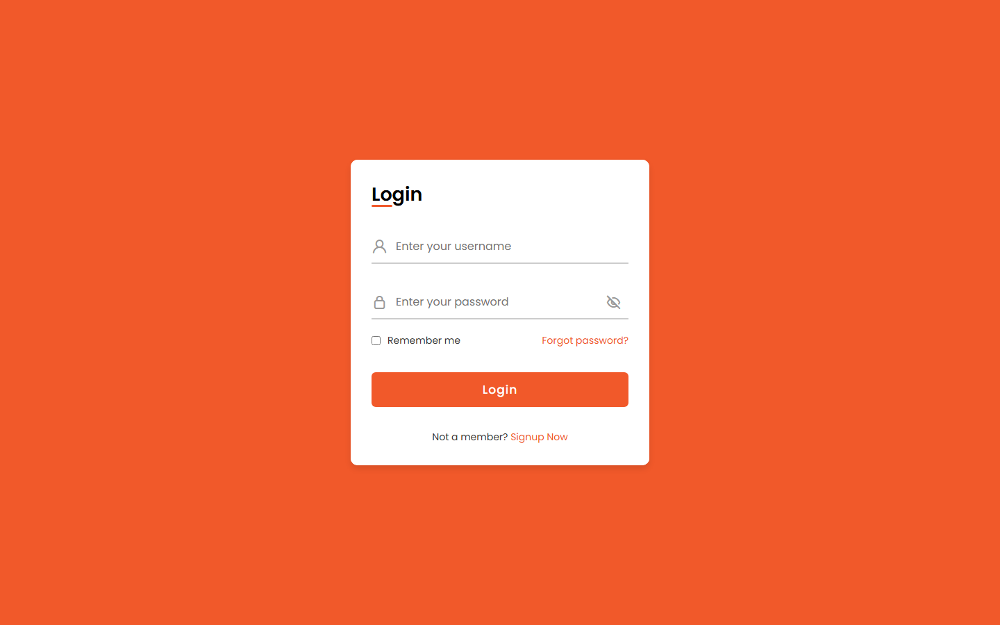
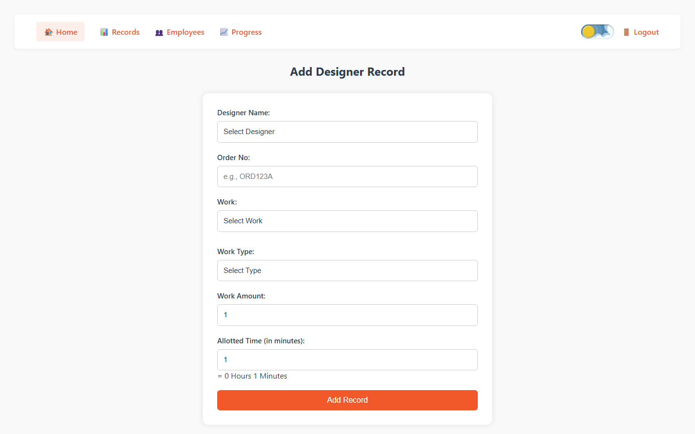
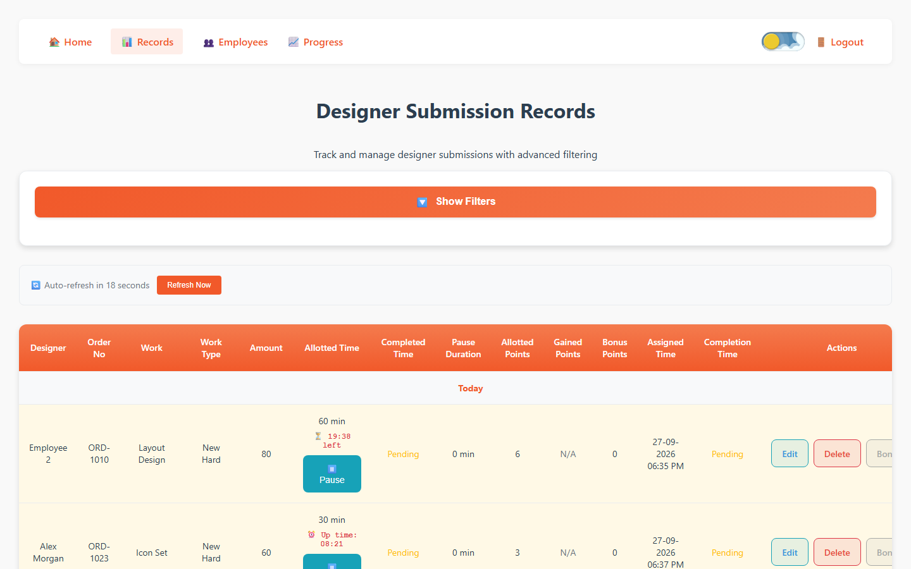
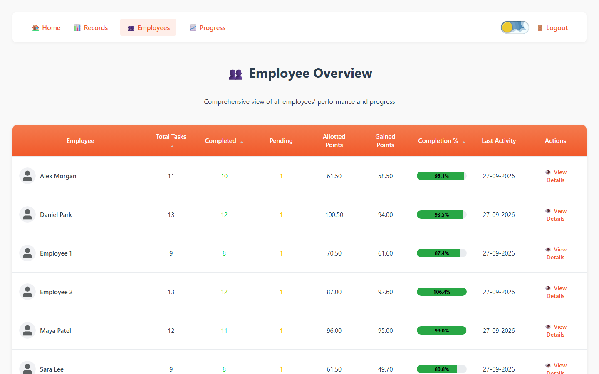
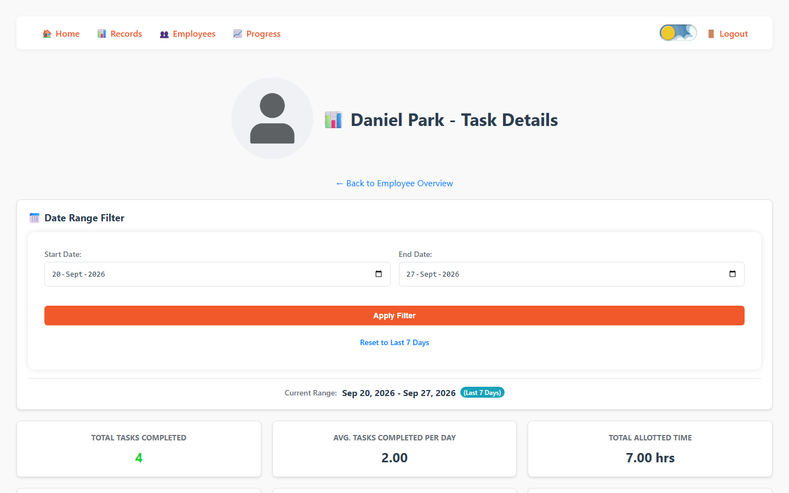
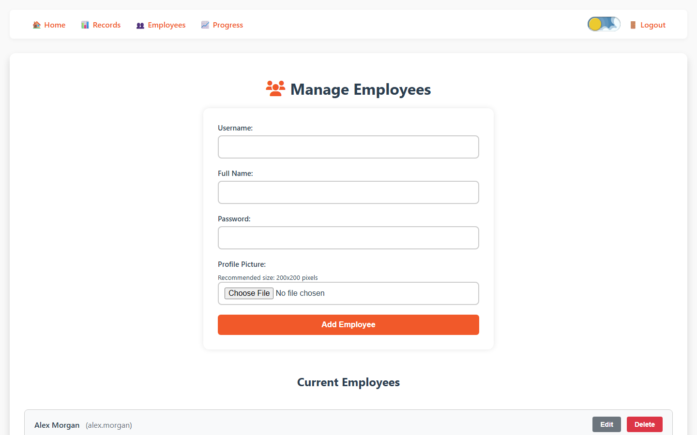
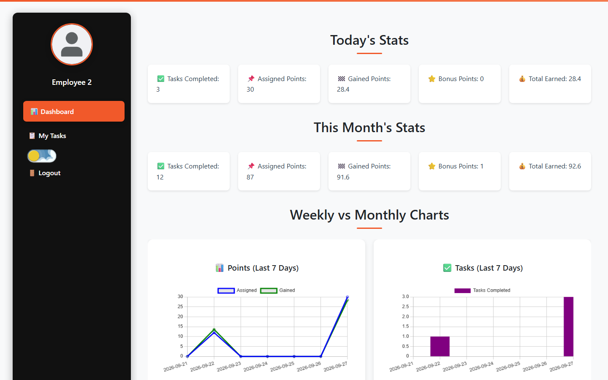
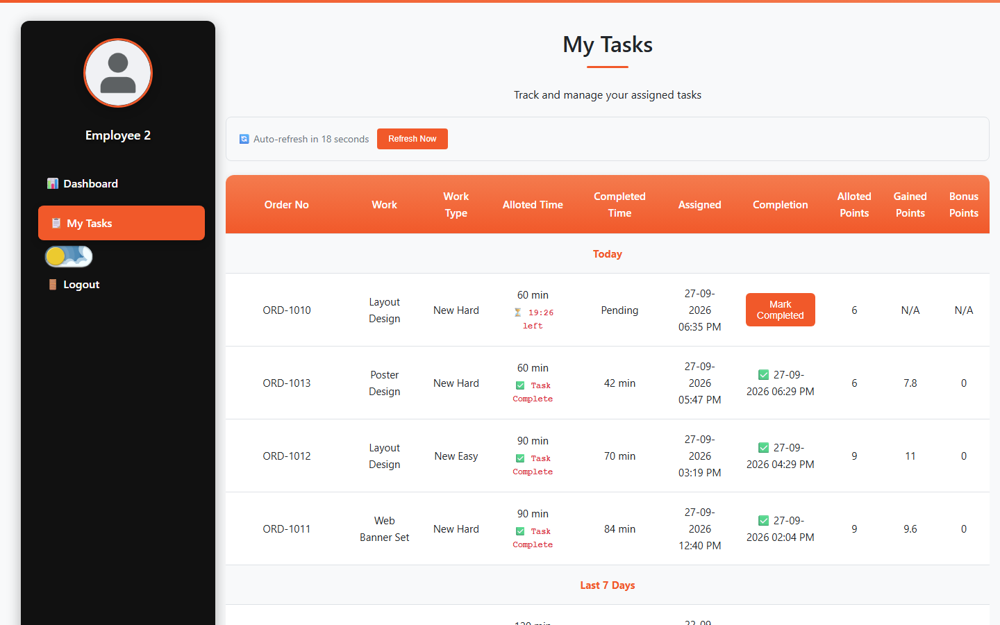
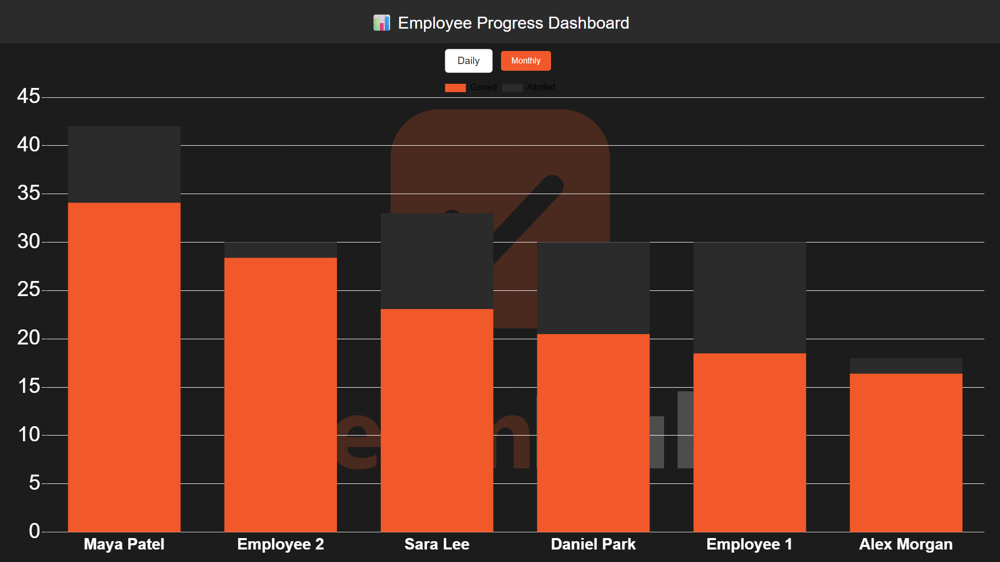

<div align="center">


# TeamHub

**Role-based task management & performance tracking for design teams**

Built with PHP · MySQL · JavaScript · Chart.js


</div>

---

## About

I designed and built TeamHub as an **in-house tool for the design agency I work at**. It replaced manual tracking of design orders with one system. Admins assign tasks, designers work through them with a live timer, and performance points are calculated automatically from how long each task took compared with the time allotted.

The project was developed with **AI-assisted engineering**: I used AI coding assistants to speed up building, refactoring and documenting the app, while I owned the requirements, architecture, data model and final review.

> This public version uses **fictional demo data** and neutral branding. No company, client or employee data is included.

## Screenshots

| Login | Admin: assign a task |
|---|---|
|  |  |

| Task records (live timers, pause / resume) | Employee overview |
|---|---|
|  |  |

| Employee detail & analytics | Manage employees |
|---|---|
|  |  |

| Employee dashboard | Employee: my tasks |
|---|---|
|  |  |

**Live progress display** (built for a wall-mounted TV in the office):



## Features

**Admin**
- Assign tasks to designers with work category, difficulty type, amount and allotted time
- Live records table with countdown timers, pause/resume, edit, delete, and filters by designer, date and work
- Employee overview with completion %, allotted vs. gained points, and last activity
- Per-employee analytics with date-range filters
- Bonus points with a reason, stored in a full audit log
- Add, edit and remove employees, including profile pictures
- Export to CSV
- Full-screen daily and monthly leaderboard for an office TV, with a pop-up and sound when bonus points are awarded

**Employee**
- Personal dashboard with today's and this month's stats, plus weekly and monthly charts
- Task list grouped by Today, Last 7 Days and older, with live timers
- Mark tasks complete; points are calculated instantly

**Platform**
- Role-based access control (Admin / Employee) with session guards on every page
- Passwords hashed with `password_hash()`, prepared statements for database access
- Near-real-time updates through AJAX polling and cross-tab `localStorage` events
- Dark mode toggle, responsive layout

## How scoring works

Every task has an **allotted time** in minutes.

```
allotted_points = allotted_time / 10
gained_points   = allotted_points + (allotted_time − actual_minutes) × 0.1   (never below 0)
```

Finish early and you earn more than the allotted points. Finish late and you earn fewer. Paused time is excluded from the actual minutes.

## Tech stack

| Layer | Technology |
|---|---|
| Backend | PHP (procedural, no framework), mysqli |
| Database | MySQL / MariaDB |
| Frontend | HTML, CSS, vanilla JavaScript, Chart.js, Font Awesome / Unicons |
| Server | Apache (XAMPP) |

## Run it locally

**Requirements:** [XAMPP](https://www.apachefriends.org/) (or any Apache + PHP 8 + MySQL/MariaDB setup).

1. **Get the code** into your web root:
   ```bash
   git clone https://github.com/NazimAli28/Teamhub-PHP-Task-Management-System.git C:/xampp/htdocs/teamhub
   ```
2. **Start** Apache and MySQL from the XAMPP Control Panel.
3. **Create the database.** In phpMyAdmin (`http://localhost/phpmyadmin`), create a database named `teamhub`, then import:
   - `database/teamhub.sql` (schema and demo accounts, required)
   - `database/demo_data.sql` (optional fictional tasks so the dashboards have data)
4. **Open** `http://localhost/teamhub/`

**Demo accounts**

| Role | Username | Password |
|---|---|---|
| Admin | `admin` | `Admin@123` |
| Employee | `employee` | `Employee@123` |

The optional demo data adds more employees (`alex.morgan`, `sara.lee`, `daniel.park`, `maya.patel`), all with password `Employee@123`.

**Custom database settings:** defaults are `localhost` / `root` / no password / `teamhub`. To change them, copy `config/db.local.example.php` to `config/db.local.php` and edit it. That file is git-ignored.

## Project structure

```
├── index.php              # Login
├── admin/                 # Admin pages, admin-only API, CSS/JS
├── employee/              # Employee pages, CSS
├── api/                   # JSON endpoints (tasks, pause/resume, bonus, export)
├── config/                # DB connection and one-off setup/migration scripts
├── includes/              # Shared session guard
├── database/              # teamhub.sql (schema) + demo_data.sql (fictional data)
├── assets/                # Images, sounds, progress-display backgrounds
├── docs/                  # User guides and full technical documentation
└── screenshots/           # Images used in this README
```

## Documentation

- [Quick start guide](docs/QUICK_START_GUIDE.md)
- [Admin user guide](docs/ADMIN_USER_GUIDE.md)
- [Employee user guide](docs/EMPLOYEE_USER_GUIDE.md)
- [Full technical documentation](docs/TEAMHUB_COMPLETE_DOCUMENTATION.md)

## License

© Nazim Ali. **All rights reserved.** This repository is published as a portfolio showcase. You're welcome to browse the code and run it locally to evaluate it. Any other use (copying, modifying, redistributing, or commercial use) requires written permission. See [LICENSE](LICENSE).
